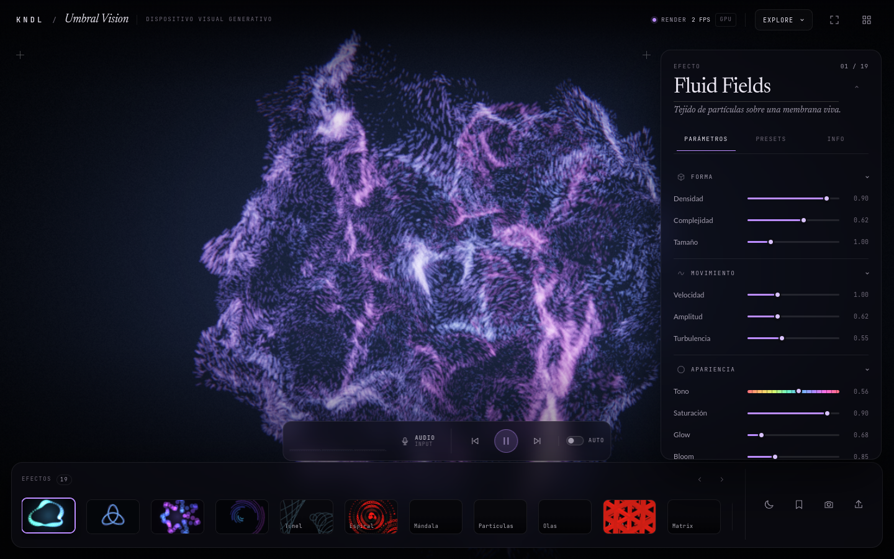
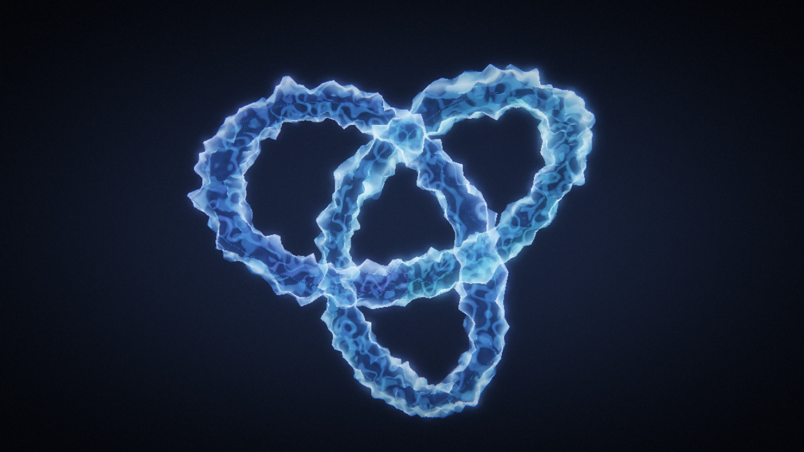
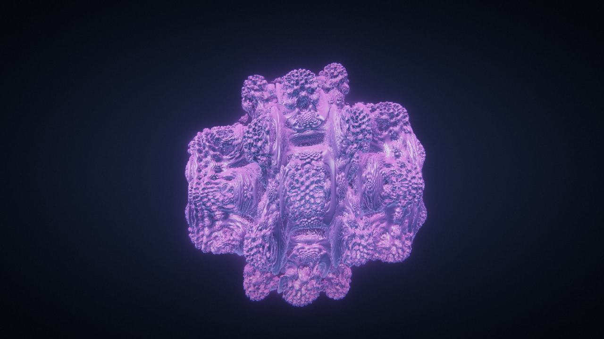
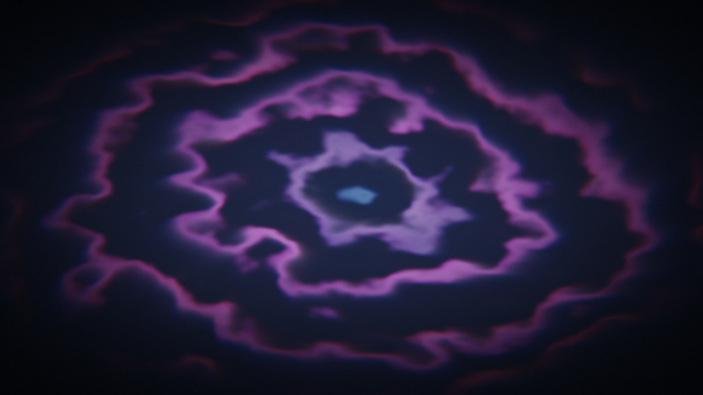
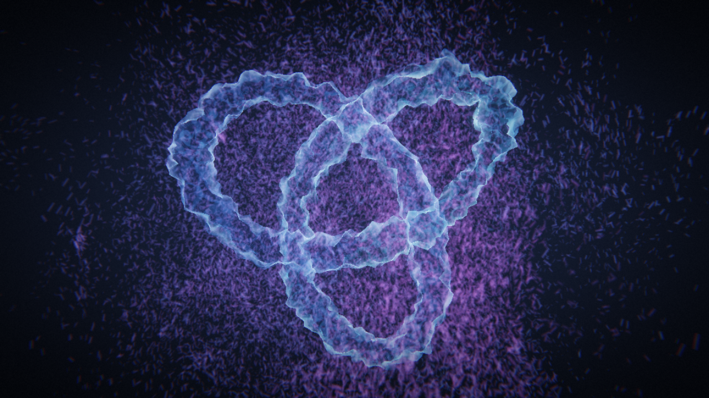
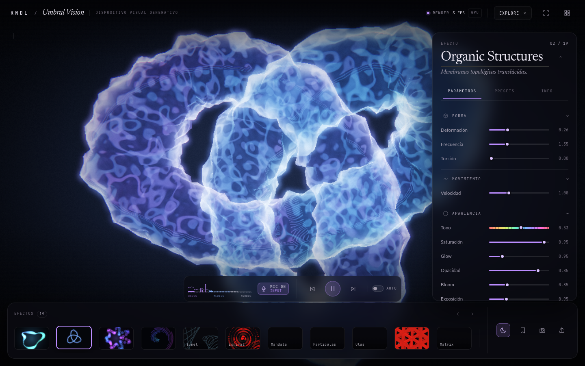

# Umbral Vision

[](https://www.npmjs.com/package/@kndl/umbral-vision)
[](https://github.com/hugomoraga/umbral-vision/actions/workflows/ci.yml)
[](https://opensource.org/licenses/MIT)

Framework modular para generación de visuales psicodélicos en tiempo real con [p5.js](https://p5js.org/). Desde v0.4 incluye un **motor de renderizado GPU (WebGL 2)** para visuales procedurales de nueva generación.



## Motor GPU (v0.4)

Cuatro familias visuales con técnicas distintas:

| Efecto | Familia | Técnica |
|---|---|---|
| `fluidFields` | Fluid Fields | partículas GPU, curl noise, domain warping, spring-to-surface |
| `organicStructures` | Organic Structures | mesh paramétrico, vertex displacement, Fresnel y tejido translúcido |
| `mathematicalForms` | Mathematical Forms | Mandelbulb raymarched, SDF, normales por gradiente, volumen |
| `temporalVeil` | Temporal Systems | feedback ping-pong, acumulación temporal, estelas y distorsión |

- Simulación GPU con texturas ping-pong (MRT) y estado determinista por seed.
- Pipeline HDR: bright pass, bloom multi-mip, tonemap ACES, viñeta, grano y aberración.
- **Cross-fade** entre efectos GPU antes del bloom.
- **Audio reactivo profundo**: kick con detección de tempo y grilla 4/4, bandas
  graves/medios/agudos con deformación distinta, volumen RMS y espectro en vivo.
  Todos los valores viven en `src/audio/audio-map.json`.
- **Studio UI**: panel por tabs, parámetros agrupados, presets, dock de efectos,
  transporte, modo inmersivo con auto-hide y responsive móvil.
- Perfiles `lite` / `high` / `ultra` + resolución adaptativa.
- El motor es independiente de la UI; los 15 efectos p5 siguen intactos.

<p align="center">
  
  
</p>
<p align="center">
  
  
</p>

### Uso

```javascript
import { startVisualizer, setEffectParameters } from '@kndl/umbral-vision';

startVisualizer('fluidFields');                  // efecto GPU
setEffectParameters({ speed: 1.3, hue: 0.03 });   // parámetros en runtime
startVisualizer('organicStructures');             // cross-fade automático (1s)
// La reacción musical se ajusta en src/audio/audio-map.json
// o en runtime: setAudioOverride('kick.depth', 0.9)
```

O sin la UI:

```javascript
import { createEngine } from '@kndl/umbral-vision';

const engine = createEngine({
  container: document.querySelector('#stage'),
  effectName: 'fluidFields',
  quality: 'high' // 'auto' | 'lite' | 'high' | 'ultra'
});
engine.setParameters({ density: 0.8, audio: 1 });
engine.getStats();
// engine.dispose();
```

Demo: `examples/fluid.html` y benchmark: `examples/bench.html`
(requieren un servidor HTTP por ES modules).

Documentación técnica: [docs/ENGINE.md](https://github.com/hugomoraga/umbral-vision/blob/main/docs/ENGINE.md) y [docs/AUDIT.md](https://github.com/hugomoraga/umbral-vision/blob/main/docs/AUDIT.md).

## Install

```bash
npm install @kndl/umbral-vision
```

> **Peer dependency**: este paquete requiere [`p5`](https://www.npmjs.com/package/p5) v1.x o v2.x. El consumidor debe proveerlo (típicamente vía CDN).

## Usage

### Browser (con bundler)

```javascript
import { startVisualizer, Effects } from '@kndl/umbral-vision';

// Iniciar visualizador con un efecto
startVisualizer('tunnel');

// Cambiar efecto
import { changeEffect } from '@kndl/umbral-vision';
changeEffect('spiral');
```

### Browser (sin bundler, con CDN)

```html
<script src="https://cdnjs.cloudflare.com/ajax/libs/p5.js/1.11.2/p5.min.js"></script>
<script type="module">
  import { startVisualizer } from 'https://cdn.jsdelivr.net/npm/@kndl/umbral-vision/dist/index.mjs';
  startVisualizer('tunnel');
</script>
```

### Activar reactividad al audio

```javascript
import { initAudio, getAudioState, stopAudio } from '@kndl/umbral-vision';

await initAudio();
const { enabled, level } = getAudioState();
stopAudio();
```

### Auto-transición

```javascript
import { startAutoTransition, stopAutoTransition, changeEffect } from '@kndl/umbral-vision';

startAutoTransition(10000, ['tunnel', 'spiral', 'mandala'], (effectName) => {
  changeEffect(effectName);
});
```

## API

### Visualizer

- `startVisualizer(effectName, container?)` — Inicia visualizador con un efecto
- `changeEffect(effectName)` — Cambia el efecto actual
- `getCurrentEffect()` — Obtiene el nombre del efecto activo
- `getAvailableEffects()` — Lista de efectos disponibles
- `stopVisualizer()` — Detiene y limpia el canvas
- `setEffectParameters(patch)` — Cambia parámetros del efecto GPU en runtime
- `getEffectParameters()` — Parámetros actuales (serializables)
- `getEffectSchema()` — Schema con defaults/rangos del efecto activo
- `getEngineStats()` — FPS, ms de CPU, resolución, partículas y perfil
- `setEngineQuality('lite'|'high'|'ultra')` — Cambia perfil en caliente

### Engine

- `createEngine({ container, canvas?, effectName, quality, params?, autoStart? })`
  — Instancia independiente del motor WebGL 2
- `ENGINE_EFFECTS` — Registro de efectos GPU
- `isEngineEffect(name)` / `getEngineEffectNames()`

### Audio map

- `loadAudioMap(url?)` — carga/recarga `audio-map.json` + overrides
- `getAudioMap()` — configuración efectiva
- `setAudioOverride('kick.depth', 0.9)` — override en vivo (persiste en localStorage)
- `resetAudioOverrides()` — vuelve al JSON/backend

El archivo editable es `src/audio/audio-map.json` (se copia a `dist/` en el build).
También se puede inyectar `window.UV_AUDIO_MAP` desde el backend.

### AudioReactive

- `initAudio()` — Inicializa análisis de audio del micrófono (async)
- `stopAudio()` — Detiene análisis y libera recursos
- `getAudioState()` — Retorna `{ enabled, level }`
- `getFrequencyData()` — Retorna `Uint8Array` con datos FFT crudos
- `getAudioFeatures()` — `{ enabled, level, rms, bass, mid, high, beat, energy }` (mismo objeto por frame)

### Transition

- `startAutoTransition(intervalMs, effectNames[], onChange)` — Inicia transiciones automáticas
- `stopAutoTransition()` — Detiene transiciones
- `isAutoTransitionEnabled()` — Booleano

### Effects

- `Effects.tunnel(sketch)` — Túnel de elipses concéntricas
- `Effects.spiral(sketch)` — Espiral psicodélico con colores cambiantes
- `Effects.mandala(sketch)` — Mandala rotativo
- `Effects.particles(sketch)` — Partículas reactivas
- `Effects.waves(sketch)` — Olas de audio
- `Effects.fractal(sketch)` — Árbol fractal
- `Effects.matrix(sketch)` — Lluvia Matrix
- `Effects.glitch(sketch)` — Glitch art
- `Effects.melt(sketch)` — Efecto melt/drip
- `Effects.fractalGlitch(sketch)` — Fractal con glitches aleatorios
- `Effects.waveGlitch(sketch)` — Olas con bandas de glitch horizontales
- `Effects.sacredGeometry(sketch)` — Geometría sagrada (Flower of Life)
- `Effects.biomech(sketch)` — Biomechánico orgánico
- `Effects.dune(sketch)` — Dunas suaves
- `Effects.yinYang(sketch)` — Símbolo Yin-Yang audio-reactivo

Efectos GPU (no usan p5):

- `fluidFields` — Membrana de partículas con curl noise, bloom y audio reactivo
- `organicStructures` — Torus knot orgánico con displacement y shading translúcido
- `mathematicalForms` — Mandelbulb raymarched con glow volumétrico
- `temporalVeil` — Feedback temporal con estelas y distorsión

Transiciones: `changeEffect('organicStructures')` hace cross-fade GPU de ~1 s.
La studio UI muestra parámetros generados desde el schema, los conserva por efecto y
los comparte por URL (`p=`). La interfaz se oculta sola al quedar inactiva y vuelve al
mover el mouse; `H` alterna el modo inmersivo.

Controles de audio y espectro en vivo:



El kick genera un impulso físico (spring-damper) sincronizado a la grilla 4/4;
los medios y agudos deforman la superficie de forma continua, sin jitter.

## Peer Dependencies

- `p5`: `^1.0.0 || ^2.0.0`

## Browser support

- Chrome / Edge / Firefox / Safari evergreen (ES2022)
- Mobile Safari iOS 14+
- Chrome Android 90+

## License

MIT © 2026 hugomoraga

## Links

- [Repository](https://github.com/hugomoraga/umbral-vision)
- [Issues](https://github.com/hugomoraga/umbral-vision/issues)
- [Origin repo (kndl000)](https://github.com/hugomoraga/kndl000)
