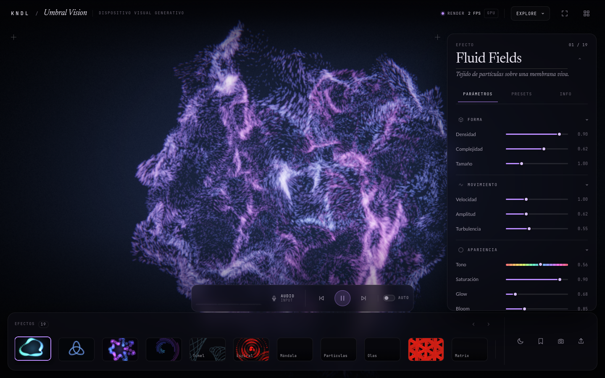
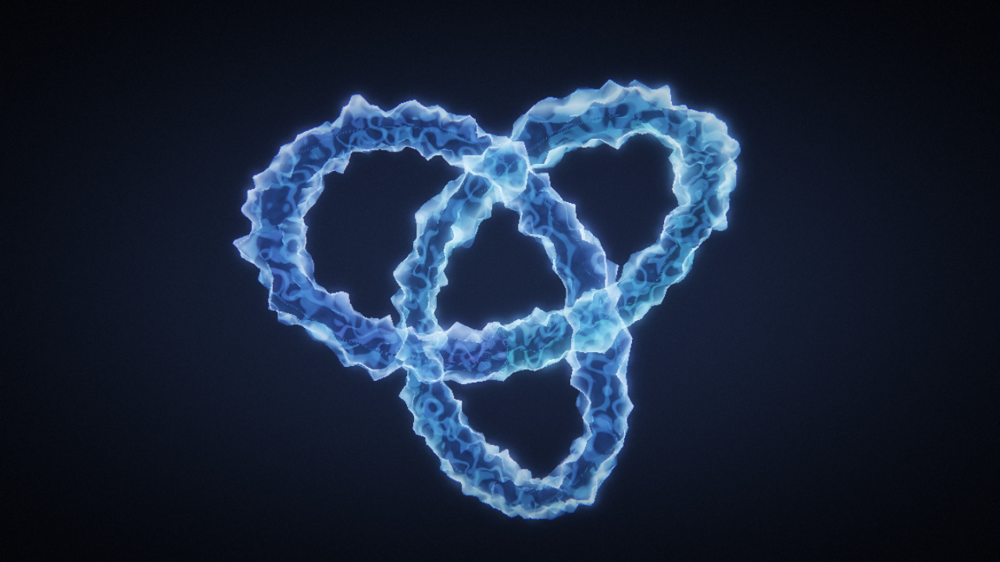
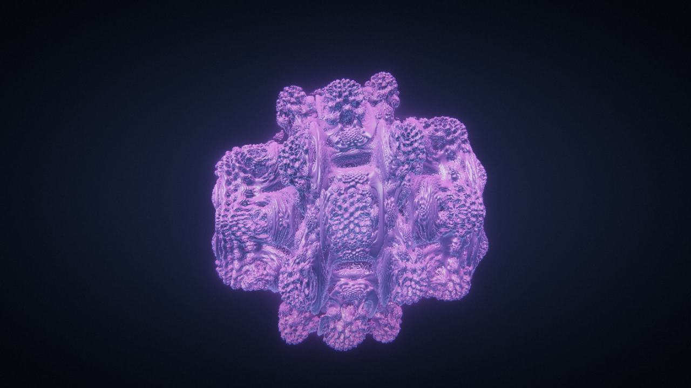
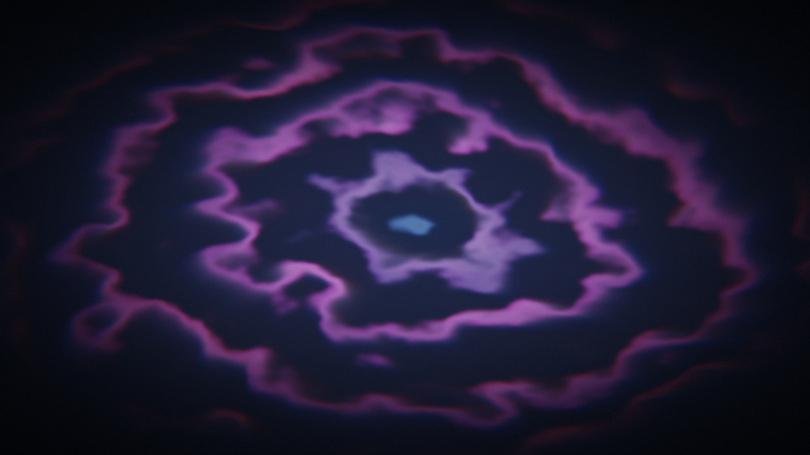
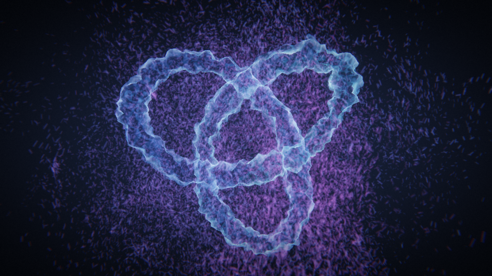
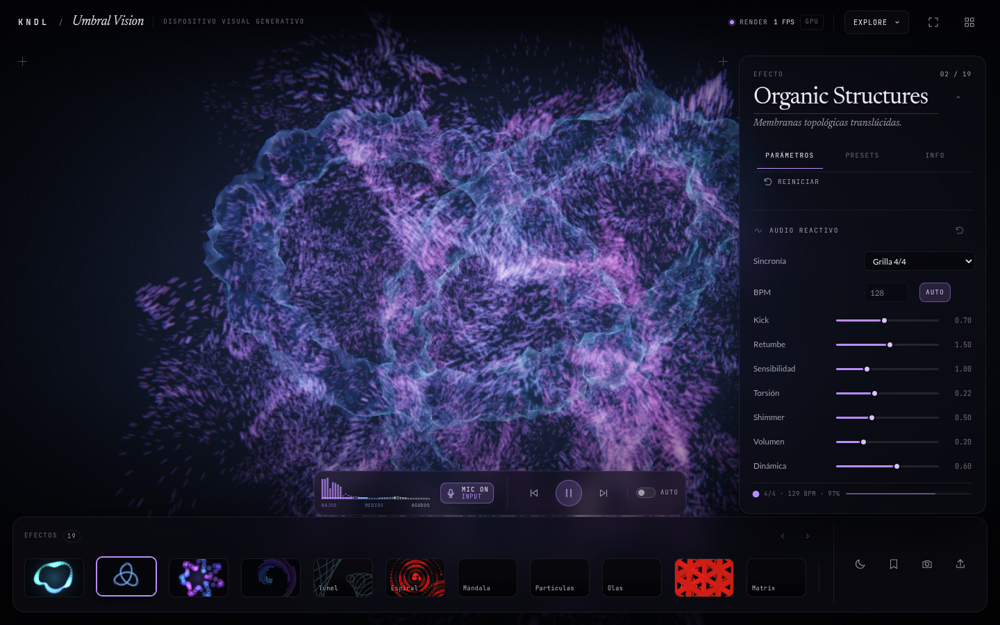

# Umbral Vision — Generative Visual Engine (v0.9)

Estado: **Slices 1–7 + studio UI + motor de audio con kick/tempo (v0.9)**.
Cuatro familias GPU: **Fluid Fields**, **Organic Structures**, **Mathematical Forms** y
**Temporal Systems**. Los 15 efectos p5 siguen funcionando sin cambios.



---

## 1. Decisiones arquitectónicas

| Decisión | Por qué |
|---|---|
| **WebGL 2 + GLSL ES 3.00, sin Three.js** | El primer efecto necesita un renderer mínimo (fullscreen quad, instancing, FBOs). Three.js sumaría ~150 KB y un modelo de escena que todavía no usamos. Se puede adoptar después si aparecen escenas/cámaras complejas. |
| **Motor paralelo, no reescritura** | Los 15 efectos p5 y la UI están estables y testeados. El motor nuevo se activa solo para efectos GPU; cero regresiones. |
| **JS + JSDoc, esbuild** | El paquete publica ESM/CJS con esbuild. Migrar a TS/Vite ahora obligaría a tocar build, tests y consumidores. El contrato está tipado con JSDoc y es migrable sin cambiar APIs. |
| **Efectos con scene target propio + post compartido** | Cada efecto controla su dibujo; bloom/tonemap/grano son responsabilidad del engine. Evita duplicar pipelines. |
| **Simulación de partículas en GPU (MRT ping-pong)** | Posición y velocidad viven en texturas `RGBA32F` (fallback `RGBA16F`); la CPU solo inicializa una vez. |
| **Canvas separado del de p5** | p5 no puede ceder su contexto 2D. Se oculta el canvas inactivo y la captura PNG elige el visible. |
| **Sin WebGPU todavía** | WebGL 2 cubre el objetivo y tiene soporte universal. La interfaz `Renderer`/`Effect` permite un backend WebGPU futuro. |

## 2. Arquitectura

```
src/audio/
  audio-map.json           configuración de reacción musical
  audioConfig.js           fetch + merge + overrides
  motion.js                spring-damper compartido + fase de flujo

src/engine/
  UmbralEngine.js          loop, ciclo de vida, audio, métricas, calidad
  registry.js              catálogo GPU + preview 2D para thumbnails
  core/
    Renderer.js            WebGL2, canvas, DPR, resize, resolución adaptativa
    Program.js             compile/link + uniformes tipados
    Geometry.js            fullscreen quad + sprite instanciado
    RenderTarget.js        FBO/color texture (rgba8/16f/32f) + soporte
    PostPipeline.js        bright pass → bloom multi-mip → composite
    Quality.js             perfiles lite/high/ultra + adaptativo
  shaders/
    common.js              simplex 3D, curl noise, paletas, ACES
    fluid.js               update (sim) + vertex/fragment de partículas
    post.js                bright/blur/copy/composite/mix (cross-fade)
  effects/
    Effect.js              contrato + schema de parámetros
    FluidFields.js         membrana de partículas GPU
    OrganicStructures.js   mesh orgánico con displacement
    MathematicalForms.js   Mandelbulb raymarched
    TemporalVeil.js        feedback de framebuffer
  shaders/
    organic.js             vertex displacement + Fresnel/venas
    mathematical.js        SDF + ray marching
    temporal.js            acumulación / estelas
  math/
    mat4.js                perspective/lookAt/multiply
    organicGeometry.js     torus knot procedural (testeable)
    random.js              mulberry32 + hash determinista
  core/Mesh.js             VAO/VBO indexado
```

### Contrato de efecto

```js
class Effect {
  static schema = { /* { type, default, min, max, label } */ };
  initialize();
  update(dt, audioFeatures);
  render(renderer);          // dibuja en this.sceneTarget
  setParameters(patch);      // valida/clampea, devuelve cambiados
  getParameters();           // copia serializable
  getPostParams();           // bloom/exposure/…
  onResize(width, height);
  dispose();
}
```

Cualquier efecto nuevo (Organic Structures, Mathematical Forms, Temporal) implementa
esto y se registra en `ENGINE_EFFECTS`; la UI no necesita cambios.

### Flujo por frame

```
rAF
 └─ UmbralEngine.frame(now)
     ├─ tickAudio() → AudioReactive (FFT, bandas, RMS, beat, smoothing)
     ├─ effect.update(dt, features)
     │    └─ FluidFields: simulación GPU (MRT ping-pong) + cámara
     ├─ effect.render(renderer)
     │    └─ sceneTarget (RGBA16F): partículas aditivas con motion stretch
     ├─ PostPipeline.render(scene, canvas)
     │    ├─ bright pass (½ res)
     │    ├─ blur separable multi-mip (½, ¼, ⅛)
     │    └─ composite: HDR + bloom + ACES + gamma + viñeta + grano + aberración
     └─ métricas + resolución adaptativa
```

## 3. Fluid Fields

### Técnica

1. **Distribución sobre una membrana paramétrica**: cada texel es una partícula con
   posición inicial sobre un cilindro abierto plegado (`radius = f(v) + sin(3θ+2v)…`),
   con `u` desplazada por fila (golden-ratio) para romper la costura.
2. **Curl noise de 2 octavas** (potencial 3D por diferencias finitas): campo sin
   divergencia; el tejido fluye sin colapsar.
3. **Domain warping**: el punto donde se evalúa el ruido se deforma con el tiempo y
   con los medios del audio.
4. **Spring hacia el home**: `accel += (home - pos) * spring`. Esto es lo que evita
   "partículas aleatorias flotando": la superficie se mantiene y respira.
5. **Beat**: impulso radial que atraviesa la membrana.
6. **Vida cíclica** con fade-in/out y respawn sobre el home → sin saltos.
7. **Render instanciado** (un quad por partícula, `gl_InstanceID` + `texelFetch`),
   estirado según la velocidad proyectada + tangente de la membrana, color por
   profundidad/parámetro, blending aditivo HDR.
8. **Bloom** sobre umbral suave + tonemap ACES; la atmósfera y la viñeta dan volumen.

### Parámetros (runtime, serializables)

`density`, `speed`, `amplitude`, `complexity`, `turbulence`, `hue`, `saturation`,
`glow`, `particleSize`, `bloom`, `exposure`, `audio`, `seed`.

```js
import { startVisualizer, setEffectParameters, getEffectParameters } from '@kndl/umbral-vision';
startVisualizer('fluidFields');
setEffectParameters({ speed: 1.4, hue: 0.03, density: 0.7 });
console.log(getEffectParameters());
```

Cambiar `seed` reconstruye la membrana (reproducibilidad). El resto es live.

### Variación cromática

El mismo efecto con `hue: 0.035`, `seed: 47`:


## 4. Las cuatro familias

| Efecto | Familia | Técnica matemática / gráfica |
|---|---|---|
| `fluidFields` | Fluid Fields | partículas GPU, curl noise, domain warping, spring-to-surface |
| `organicStructures` | Organic Structures | superficie paramétrica (torus knot), displacement, Fresnel |
| `mathematicalForms` | Mathematical Forms | Mandelbulb raymarched, SDF, gradiente, oclusión |
| `temporalVeil` | Temporal Systems | ping-pong de framebuffer, acumulación, estelas |

### Organic Structures

Mesh generado en CPU (`src/engine/math/organicGeometry.js`): trefoil knot con tubo
orgánico, torsión y pliegues deterministas por seed. El vertex shader desplaza cada
vértice por la normal con fbm 3D + audio; el fragment shader compone venas, Fresnel,
diffuse/backlight y capas translúcidas aditivas. No usa partículas ni ray marching.



### Mathematical Forms

Mandelbulb en un fragment shader: SDF iterativo, ray marching con presupuesto de
pasos según perfil/detalle, normales por gradiente tetraédrico, oclusión aproximada
por número de pasos de marcha y acumulación de aura volumétrica. La potencia del
fractal y el warp responden al audio.



### Temporal Systems

Dos render targets HDR en ping-pong. Cada frame muestrea el anterior con zoom,
rotación, aberración y distorsión por ruido, lo atenúa (`decay`) y le suma emisores
de filamentos radiales. El resultado expone el target recién escrito como escena
para el post-proceso compartido.



## 5. Transiciones (cross-fade GPU)

`PostPipeline` incluye un pase `mix` que combina dos scene targets antes del bright
pass/bloom. El engine mantiene el efecto saliente vivo durante la transición,
actualiza y renderiza ambos, y aplica smoothstep al `uMix`.

```js
engine.setEffect('organicStructures', undefined, { transitionMs: 1000 });
```

- Cambio entre efectos GPU: 1 s por defecto.
- GPU → p5 y p5 → GPU: instantáneo (no comparten pipeline).
- La UI/auto-transición lo usan automáticamente.
- `transitioning` y progreso visibles en `getEngineStats()`.



## 6. Audio → visual (v0.8)

### Detector y sincronía

- Kick: spectral flux en **35–120 Hz**, umbral adaptativo, refractario configurable
  (mínimo adaptativo de 0.85 × negra para evitar dobles onsets).
- Tempo: intervalos entre kicks plegados al rango 80–180 BPM, mediana + MAD para
  confianza. BPM manual posible.
- Modos: `grid` (4/4), `kick` (onset real), `off`.
- Trigger visual con **latencia configurable** (28 ms por defecto).
- Un onset no mueve la geometría: genera una señal `kickTrigger` que el efecto
  convierte en **impulso físico** (spring-damper).

### Features

| Feature | Uso |
|---|---|
| `bassBody` | respiración lenta, escala y cuerpo |
| `midFlow` | ondulación/torsión continua, fase viajera |
| `highShimmer` | porosidad, shimmer y micro-desplazamiento |
| `kick` | envelope lento del golpe (cuerpo / retumbe) |
| `kickFlash` | transiente rápido para bloom/exposición |
| `kickTrigger` / `kickStrength` | evento de golpe |
| `bpm` / `beatPhase` / `tempoConfidence` | grilla e indicadores UI |
| `rms` | volumen absoluto |

### Configuración: `src/audio/audio-map.json`

Todos los valores abstractos viven en el JSON:

```json
{
  "sync": { "mode": "grid", "bpm": "auto", "fallbackBpm": 128,
            "minBpm": 80, "maxBpm": 180, "visualLatencyMs": 28 },
  "kick": { "rangeHz": [35, 120], "refractoryMs": 180, "threshold": 1.55,
            "minFlux": 0.006, "sensitivity": 1, "depth": 0.7,
            "decaySec": 1.5, "spring": 18, "damping": 4.5,
            "cameraDolly": 0.03, "bloomPulse": 0.18 },
  "bassBody": { "attackMs": 80, "releaseMs": 800, "scale": 0.05 },
  "midFlow": { "attackMs": 120, "releaseMs": 600, "twist": 0.22,
               "waveSpeed": 0.8, "waveAmp": 0.12 },
  "highShimmer": { "attackMs": 15, "releaseMs": 180,
                   "porosity": 0.5, "microDisplace": 0.012 },
  "volume": { "exposure": 0.2, "bloom": 0.15 },
  "dynamics": { "autoGain": 0.6, "floor": 0.04 },
  "effects": {
    "fluidFields": { "kick": 1, "body": 0.7, "mid": 0.9, "high": 1 },
    "organicStructures": { "kick": 1, "body": 0.8, "mid": 1, "high": 1 },
    "mathematicalForms": { "kick": 1, "body": 0.5, "mid": 0.8, "high": 0.8 },
    "temporalVeil": { "kick": 1, "body": 0.6, "mid": 0.9, "high": 0.8 }
  }
}
```

Prioridad: defaults embebidos → `audio-map.json` → `window.UV_AUDIO_MAP` → overrides
de la UI en localStorage. El JSON se puede editar sin tocar código.

### Las cuatro familias

| Familia | Kick | Graves | Medios | Agudos |
|---|---|---|---|---|
| Fluid Fields | impulso radial en la simulación + dolly de cámara | velocidad/flujo lento | turbulencia del campo | tamaño/brillo/detalle de partículas |
| Organic Structures | spring de escala + onda viajera + dolly | respiración | torsión + onda lateral | porosidad + shimmer |
| Mathematical Forms | dolly + potencia/warp | potencia fractal | roll de cámara + warp | warp de alta frecuencia |
| Temporal Veil | zoom del feedback + emisión | zoom/persistencia | rotación de estelas | aberración/detalle |

Todas comparten `AudioMotion` (spring + fase) y los gains por efecto de
`audio-map.json → effects.<efecto>`. Ninguna usa bandas crudas frame a frame.

La UI expone sincronía, BPM auto/manual, kick, retumbe, sensibilidad, torsión,
shimmer, volumen y dinámica, más BPM/fase/confianza en vivo.



## 7. Studio UI (v0.7)