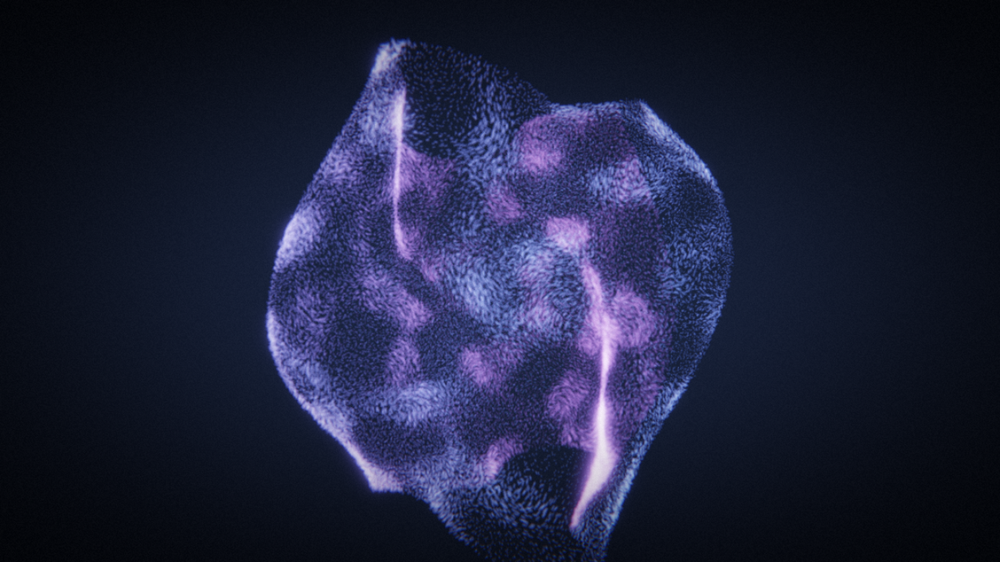
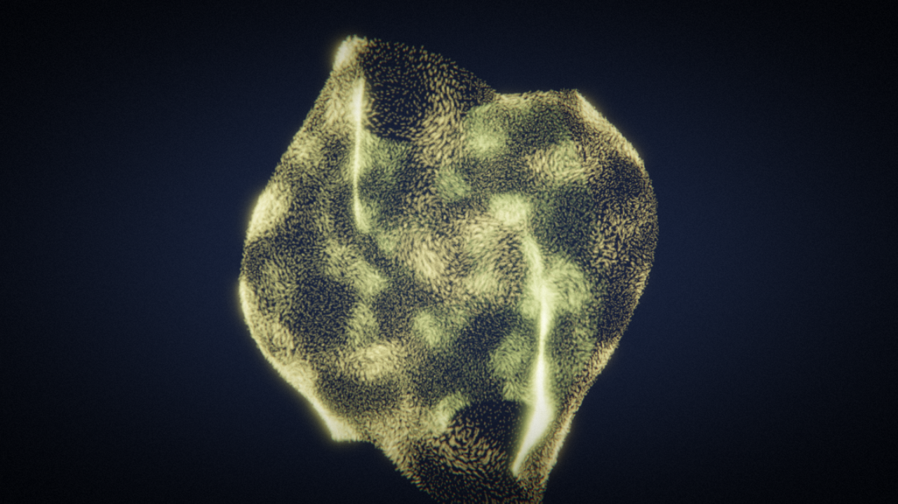
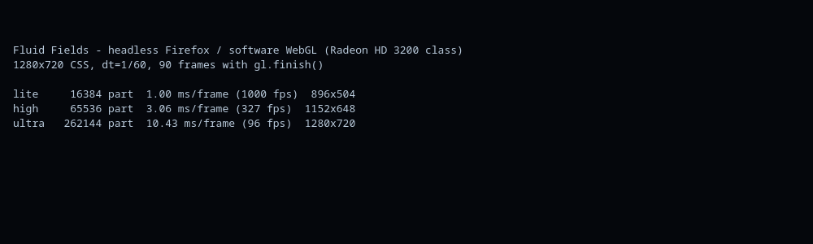
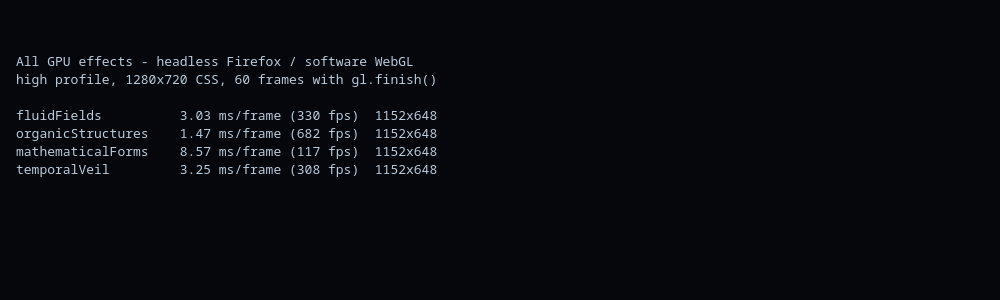

# Umbral Vision — Generative Visual Engine (v0.4)

Estado: **Slices 1–6 implementados + integración con la app existente**.
Cuatro familias GPU: **Fluid Fields**, **Organic Structures**, **Mathematical Forms** y
**Temporal Systems**. Los 15 efectos p5 siguen funcionando sin cambios.



---

## 1. Decisiones arquitectónicas

| Decisión | Por qué |
|---|---|
| **WebGL 2 + GLSL ES 3.00, sin Three.js** | El primer efecto necesita un renderer mínimo (fullscreen quad, instancing, FBOs). Three.js sumaría ~150 KB y un modelo de escena que todavía no usamos. Se puede adoptar después si aparecen escenas/cámaras complejas. |
| **Motor paralelo, no reescritura** | Los 15 efectos p5 y la UI están estables y testeados. El motor nuevo se activa solo para efectos GPU; cero regresiones. |
| **JS + JSDoc, esbuild** | El paquete publica ESM/CJS con esbuild. Migrar a TS/Vite ahora obligaría a tocar build, tests y consumidores. El contrato está tipado con JSDoc y es migrable sin cambiar APIs. |
| **Efectos con scene target propio + post compartido** | Cada efecto controla su dibujo; bloom/tonemap/grano son responsabilidad del engine. Evita duplicar pipelines. |
| **Simulación de partículas en GPU (MRT ping-pong)** | Posición y velocidad viven en texturas `RGBA32F` (fallback `RGBA16F`); la CPU solo inicializa una vez. |
| **Canvas separado del de p5** | p5 no puede ceder su contexto 2D. Se oculta el canvas inactivo y la captura PNG elige el visible. |
| **Sin WebGPU todavía** | WebGL 2 cubre el objetivo y tiene soporte universal. La interfaz `Renderer`/`Effect` permite un backend WebGPU futuro. |

## 2. Arquitectura

```
src/engine/
  UmbralEngine.js          loop, ciclo de vida, audio, métricas, calidad
  registry.js              catálogo GPU + preview 2D para thumbnails
  core/
    Renderer.js            WebGL2, canvas, DPR, resize, resolución adaptativa
    Program.js             compile/link + uniformes tipados
    Geometry.js            fullscreen quad + sprite instanciado
    RenderTarget.js        FBO/color texture (rgba8/16f/32f) + soporte
    PostPipeline.js        bright pass → bloom multi-mip → composite
    Quality.js             perfiles lite/high/ultra + adaptativo
  shaders/
    common.js              simplex 3D, curl noise, paletas, ACES
    fluid.js               update (sim) + vertex/fragment de partículas
    post.js                bright/blur/copy/composite/mix (cross-fade)
  effects/
    Effect.js              contrato + schema de parámetros
    FluidFields.js         membrana de partículas GPU
    OrganicStructures.js   mesh orgánico con displacement
    MathematicalForms.js   Mandelbulb raymarched
    TemporalVeil.js        feedback de framebuffer
  shaders/
    organic.js             vertex displacement + Fresnel/venas
    mathematical.js        SDF + ray marching
    temporal.js            acumulación / estelas
  math/
    mat4.js                perspective/lookAt/multiply
    organicGeometry.js     torus knot procedural (testeable)
    random.js              mulberry32 + hash determinista
  core/Mesh.js             VAO/VBO indexado
```

### Contrato de efecto

```js
class Effect {
  static schema = { /* { type, default, min, max, label } */ };
  initialize();
  update(dt, audioFeatures);
  render(renderer);          // dibuja en this.sceneTarget
  setParameters(patch);      // valida/clampea, devuelve cambiados
  getParameters();           // copia serializable
  getPostParams();           // bloom/exposure/…
  onResize(width, height);
  dispose();
}
```

Cualquier efecto nuevo (Organic Structures, Mathematical Forms, Temporal) implementa
esto y se registra en `ENGINE_EFFECTS`; la UI no necesita cambios.

### Flujo por frame

```
rAF
 └─ UmbralEngine.frame(now)
     ├─ tickAudio() → AudioReactive (FFT, bandas, RMS, beat, smoothing)
     ├─ effect.update(dt, features)
     │    └─ FluidFields: simulación GPU (MRT ping-pong) + cámara
     ├─ effect.render(renderer)
     │    └─ sceneTarget (RGBA16F): partículas aditivas con motion stretch
     ├─ PostPipeline.render(scene, canvas)
     │    ├─ bright pass (½ res)
     │    ├─ blur separable multi-mip (½, ¼, ⅛)
     │    └─ composite: HDR + bloom + ACES + gamma + viñeta + grano + aberración
     └─ métricas + resolución adaptativa
```

## 3. Fluid Fields

### Técnica

1. **Distribución sobre una membrana paramétrica**: cada texel es una partícula con
   posición inicial sobre un cilindro abierto plegado (`radius = f(v) + sin(3θ+2v)…`),
   con `u` desplazada por fila (golden-ratio) para romper la costura.
2. **Curl noise de 2 octavas** (potencial 3D por diferencias finitas): campo sin
   divergencia; el tejido fluye sin colapsar.
3. **Domain warping**: el punto donde se evalúa el ruido se deforma con el tiempo y
   con los medios del audio.
4. **Spring hacia el home**: `accel += (home - pos) * spring`. Esto es lo que evita
   "partículas aleatorias flotando": la superficie se mantiene y respira.
5. **Beat**: impulso radial que atraviesa la membrana.
6. **Vida cíclica** con fade-in/out y respawn sobre el home → sin saltos.
7. **Render instanciado** (un quad por partícula, `gl_InstanceID` + `texelFetch`),
   estirado según la velocidad proyectada + tangente de la membrana, color por
   profundidad/parámetro, blending aditivo HDR.
8. **Bloom** sobre umbral suave + tonemap ACES; la atmósfera y la viñeta dan volumen.

### Parámetros (runtime, serializables)

`density`, `speed`, `amplitude`, `complexity`, `turbulence`, `hue`, `saturation`,
`glow`, `particleSize`, `bloom`, `exposure`, `audio`, `seed`.

```js
import { startVisualizer, setEffectParameters, getEffectParameters } from '@kndl/umbral-vision';
startVisualizer('fluidFields');
setEffectParameters({ speed: 1.4, hue: 0.03, density: 0.7 });
console.log(getEffectParameters());
```

Cambiar `seed` reconstruye la membrana (reproducibilidad). El resto es live.

### Variación cromática

El mismo efecto con `hue: 0.035`, `seed: 47`:



## 4. Las cuatro familias

| Efecto | Familia | Técnica matemática / gráfica |
|---|---|---|
| `fluidFields` | Fluid Fields | partículas GPU, curl noise, domain warping, spring-to-surface |
| `organicStructures` | Organic Structures | superficie paramétrica (torus knot), displacement, Fresnel |
| `mathematicalForms` | Mathematical Forms | Mandelbulb raymarched, SDF, gradiente, oclusión |
| `temporalVeil` | Temporal Systems | ping-pong de framebuffer, acumulación, estelas |

### Organic Structures

Mesh generado en CPU (`src/engine/math/organicGeometry.js`): trefoil knot con tubo
orgánico, torsión y pliegues deterministas por seed. El vertex shader desplaza cada
vértice por la normal con fbm 3D + audio; el fragment shader compone venas, Fresnel,
diffuse/backlight y capas translúcidas aditivas. No usa partículas ni ray marching.


### Mathematical Forms

Mandelbulb en un fragment shader: SDF iterativo, ray marching con presupuesto de
pasos según perfil/detalle, normales por gradiente tetraédrico, oclusión aproximada
por número de pasos de marcha y acumulación de aura volumétrica. La potencia del
fractal y el warp responden al audio.


### Temporal Systems

Dos render targets HDR en ping-pong. Cada frame muestrea el anterior con zoom,
rotación, aberración y distorsión por ruido, lo atenúa (`decay`) y le suma emisores
de filamentos radiales. El resultado expone el target recién escrito como escena
para el post-proceso compartido.


## 5. Transiciones (cross-fade GPU)

`PostPipeline` incluye un pase `mix` que combina dos scene targets antes del bright
pass/bloom. El engine mantiene el efecto saliente vivo durante la transición,
actualiza y renderiza ambos, y aplica smoothstep al `uMix`.

```js
engine.setEffect('organicStructures', undefined, { transitionMs: 1000 });
```

- Cambio entre efectos GPU: 1 s por defecto.
- GPU → p5 y p5 → GPU: instantáneo (no comparten pipeline).
- La UI/auto-transición lo usan automáticamente.
- `transitioning` y progreso visibles en `getEngineStats()`.


## 6. Audio → visual

`AudioReactive` ahora calcula por frame un objeto reutilizado (`getAudioFeatures()`):

| Feature | Cálculo | Uso en Fluid Fields |
|---|---|---|
| `bass` (20–250 Hz) | promedio de bins + smoothing asimétrico | velocidad de simulación, pulso radial de la membrana, respiración |
| `mid` (250 Hz–2 kHz) | idem | intensidad del domain warp |
| `high` (2–12 kHz) | idem | tamaño/brillo de partículas, ruido de alta frecuencia |
| `rms` | raíz del promedio cuadrático | opacidad/energía global |
| `beat` | energía vs media móvil (43 frames) × 1.35, decay 0.9 | impulso radial + pico de brillo |
| `energy` | mezcla ponderada | disponible para futuros efectos |

Smoothing: attack 0.45 / release 0.09. El FFT pasó de 256 a 1024 para tener resolución
real de bandas. Si no hay audio, todas las features se resetean a cero.

**El audio no cambia solo color**: modifica la simulación (velocidad/amplitud/vida) y
la respuesta de render (tamaño/brillo). Verificable con `examples/fluid.html` → 🎤 Audio.

## 7. Rendimiento y calidad

| Perfil | Partículas | DPR máx | render scale | Bloom mips | Blur taps |
|---|---:|---:|---:|---:|---:|
| Lite | 16 384 | 1.0 | 0.70 | 1 | 5 |
| High | 65 536 | 1.5 | 0.90 | 2 | 9 |
| Ultra | 262 144 | 2.0 | 1.00 | 3 | 9 |

- **Resolución adaptativa**: baja 0.10 de escala tras 45 frames lentos (> target),
  recupera 0.05 tras 180 frames rápidos. Targets: Lite 22 ms, High 19 ms, Ultra 15 ms.
- **Presupuesto**: `dt` limitado a 50 ms; 1 paso de simulación por frame; `gl.finish`
  nunca se usa en producción.
- **CPU**: inicialización de buffers una vez; uniforms por nombre cacheado; sin
  allocations por frame en el loop (excepto objetos de stats bajo demanda).
- **Lite mode**: `setLiteMode(true)` emite `uv:lite-mode`; el engine cambia a perfil
  Lite en caliente sin recargar.
- **Recursos**: `dispose()` libera programas, VAOs, buffers, texturas de estado,
  FBOs, render targets y el contexto (`WEBGL_lose_context`). Context lost/restored
  reconstruye el pipeline.

### Métricas (headless Firefox, software WebGL)



| Efecto (perfil high) | Resolución | ms/frame (software) |
|---|---:|---:|
| Fluid Fields | 1152×648 | 3.03 ms |
| Organic Structures | 1152×648 | 1.47 ms |
| Mathematical Forms | 1152×648 | 8.57 ms |
| Temporal Veil | 1152×648 | 3.25 ms |

Perfiles de Fluid Fields:

| Perfil | Resolución | Partículas | ms/frame (software) |
|---|---|---:|---:|
| Lite | 896×504 | 16 384 | 1.00 ms |
| High | 1152×648 | 65 536 | 3.06 ms |
| Ultra | 1280×720 | 262 144 | 10.43 ms |

Medido con 60–90 frames de `update + render + post` y `gl.finish()` en Firefox headless
sobre rasterizador **software** (clase Radeon HD 3200). En GPU real el costo es menor;
estos números son una cota superior, no un benchmark de producción. Reproducible con
`examples/bench.html`.



## 8. Integración con la aplicación existente

| Funcionalidad | Estado |
|---|---|
| Selector / thumbnails | ✅ `getAvailableEffects()` une p5 + GPU; thumbnail 2D propia |
| Presets | ✅ guardan `params` del motor (compatibles con presets viejos) |
| Auto-transición | ✅ incluye las 4 familias GPU con cross-fade |
| Audio reactivo | ✅ comparte `AudioReactive`; el motor hace `tickAudio()` en su loop |
| Fullscreen | ✅ sin cambios |
| Captura PNG | ✅ `captureFrame` elige el canvas visible (`preserveDrawingBuffer: true`) |
| Compartir URL | ✅ `?effect=fluidFields` funciona |
| Modo Lite | ✅ perfil GPU Lite en caliente |
| Efectos p5 | ✅ intactos, mismo registro y factories |

El motor es independiente de la UI: `createEngine({ container, quality })` puede usarse
sin montar el generador. Los efectos GPU comparten contrato, post-proceso, perfiles y
transiciones.

```js
import { createEngine } from '@kndl/umbral-vision';

const engine = createEngine({
  container: document.querySelector('#stage'),
  effectName: 'fluidFields',
  quality: 'high' // 'auto' | 'lite' | 'high' | 'ultra'
});
engine.setParameters({ speed: 1.3 });
engine.getStats();
engine.dispose();
```

## 9. Cómo ejecutar

```bash
npm install
npm test            # 97 tests
npm run lint
npm run build

# demo visual (necesita servidor por ES modules)
npx serve .         # o python3 -m http.server
# → http://localhost:8000/examples/fluid.html
# → http://localhost:8000/examples/bench.html
```

## 10. Limitaciones conocidas

1. **Transiciones p5↔GPU instantáneas**: el cross-fade existe solo entre efectos GPU.
2. **Sin panel genérico de parámetros** en la UI todavía; la API y el schema están
   listos (`getEffectSchema`) y la demo los consume.
3. **Simulación float requerida** para Fluid Fields. Sin `EXT_color_buffer_float`/
   half-float el efecto no arranca (error controlado). Fallback CPU no implementado.
4. **Adaptativo basado en frame delta**, no en GPU timer query. En pantallas de 30 Hz
   puede bajar resolución de más; no afecta corrección.
5. **Sin TypeScript/Vite**. Se mantiene esbuild y JS+JSDoc.
6. **Audio**: el análisis está testeado con FFT mock; la validación con micrófono real
   requiere interacción del usuario (permiso) y no es posible en headless.
7. **Coste de Mathematical Forms**: el ray marching depende de la resolución; el
   perfil Lite reduce pasos. La resolución adaptativa global ayuda.
8. **Context restore** reconstruye el efecto desde cero (la composición se reinicia).

## 11. Validación en la app real

Ver [VALIDATION.md](VALIDATION.md): 19 efectos en el generador de `kndl000`,
cuatro familias funcionando, cross-fade, Lite, audio, PNG y presets, sin errores de
consola. La sincronización encontró y corrigió dos bugs (transición congelada y
thumbnails negros).

## 12. Próximos pasos (Slice 7+)

1. **Panel de parámetros genérico** en la UI (schema → controles) sin rediseñar.
2. **Transiciones p5↔GPU**: compositing de un canvas 2D y un target WebGL.
3. **Más variantes por familia** (atractores, túneles volumétricos, membranas celulares).
4. **GPU timer queries** para métricas reales y adaptativo por costo de GPU.
5. **Presets con seed** y parámetros en la URL compartida (hash corto).
6. **Audio**: validación con micrófono real + calibración de beat por dispositivo.
7. Evaluar **WebGPU** detrás de la misma interfaz.
