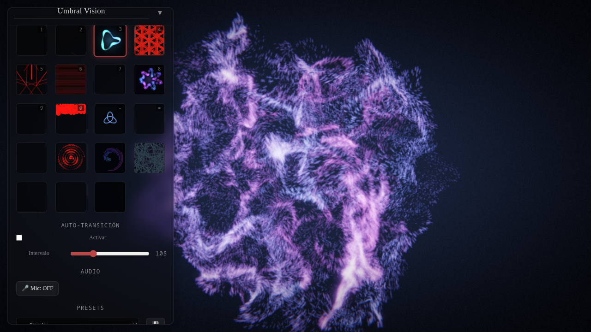

# Validación en la aplicación real (kndl000)

Fecha: 2026-11-23
Versión validada: **0.5.2** (`7f8760d`)



## Entorno

- `kndl000` (Jekyll 4.3.4) sirviendo `http://127.0.0.1:4000/visual/generator/`.
- El submodule `assets/js/umbral-vision` se carga **directo desde `src/`** por el
  layout `_layouts/generator.html` (sin bundler ni `dist`).
- Chromium 131 headless (Playwright) con WebGL 2 vía SwiftShader.
- Viewport 1280×720, perfil `high`.

> Los FPS medidos en SwiftShader (~1–25 fps) **no representan** el rendimiento en
> GPU real; solo se usaron para validar interacción y ausencia de errores.

## Resultados

| Comprobación | Resultado |
|---|---|
| Catálogo en la UI | 19 efectos / 19 thumbnails |
| WebGL 2 | disponible |
| `fluidFields` | renderiza, `1152×648`, perfil high |
| `organicStructures` | renderiza y completa el cross-fade |
| `mathematicalForms` | renderiza y completa el cross-fade |
| `temporalVeil` | renderiza y completa el cross-fade |
| Cross-fade GPU | completa; `transitioning=false` al terminar |
| Volver a p5 (`tunnel`) | canvas p5 visible, canvas GPU oculto, transición cancelada |
| Modo Lite | `quality=lite`, `896×504`, sin errores |
| Audio (WAV sintético inyectado) | `enabled=true`, `bass≈0.65`, `rms≈0.21`; al detener todo vuelve a 0 |
| Captura PNG | descarga `umbral-vision-*.png`, ~1.2 MB (canvas WebGL visible) |
| Preset | guarda `effect=fluidFields` + 13 parámetros del schema |
| Errores de consola / página | **0** |

## Incidencias encontradas y corregidas

1. **Transición congelada al volver a p5** (0.5.1): si se cambiaba a un efecto p5
   durante un cross-fade, el efecto saliente quedaba vivo y oculto, reteniendo
   recursos. `hide()` ahora cancela la transición y hace `dispose()` del saliente.
2. **Thumbnails negros** (0.5.2): solo el efecto seleccionado tenía preview. Ahora
   cada thumbnail dibuja un frame estático al construirse; el preview en vivo sigue
   reservado al activo.

## Observaciones

- La transición se mide con `dt` limitado a 50 ms por frame; en hardware extremo
  (< 5 fps) puede tardar más de 1 s. En 60 fps dura 1 s.
- El audio con `beat` no se validó de forma fiable en SwiftShader (~2 fps): el
  detector necesita muestrear transitorios a una tasa razonable. Las features de
  bandas/RMS sí se validaron, y el beat tiene tests unitarios del detector.
- `kndl000/package.json` mantiene `@kndl/umbral-vision: ^0.1.0` porque el registry
  público aún no tiene 0.5.x. El sitio usa el submodule, no ese paquete.

## Reproducir

```bash
# terminal 1
cd kndl000
bundle exec jekyll serve --host 127.0.0.1 --port 4000

# validación automatizada (requiere playwright + chromium)
node /tmp/opencode/pw/validate2.mjs
```
