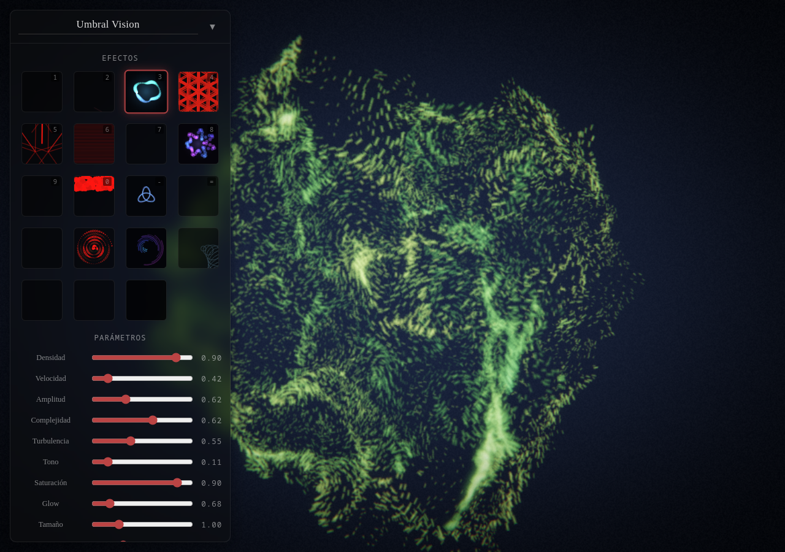

# Validación en la aplicación real (kndl000)

Fecha: 2026-11-23
Versión validada: **0.8.0**


## Entorno

- `kndl000` (Jekyll 4.3.4) sirviendo `http://127.0.0.1:4000/imaginario/generator/`
  (`/visual/generator/` redirige a la ruta canónica `/imaginario/generator/`).
- El submodule `assets/js/umbral-vision` se carga **directo desde `src/`** por el
  layout `_layouts/generator.html` (sin bundler ni `dist`).
- Chromium 131 headless (Playwright) con WebGL 2 vía SwiftShader.
- Viewport 1280×720, perfil `high`.

> Los FPS medidos en SwiftShader (~1–25 fps) **no representan** el rendimiento en
> GPU real; solo se usaron para validar interacción y ausencia de errores.

## Resultados

| Comprobación | Resultado |
|---|---|
| Catálogo en la UI | 19 efectos / 19 thumbnails |
| WebGL 2 | disponible |
| `fluidFields` | renderiza, `1152×648`, perfil high |
| `organicStructures` | renderiza y completa el cross-fade |
| `mathematicalForms` | renderiza y completa el cross-fade |
| `temporalVeil` | renderiza y completa el cross-fade |
| Cross-fade GPU | completa; `transitioning=false` al terminar |
| Volver a p5 (`tunnel`) | canvas p5 visible, canvas GPU oculto, transición cancelada |
| Modo Lite | `quality=lite`, `896×504`, sin errores |
| Audio (WAV sintético inyectado) | `enabled=true`, `bass≈0.65`, `rms≈0.21`; al detener todo vuelve a 0 |
| Captura PNG | descarga `umbral-vision-*.png`, ~1.2 MB (canvas WebGL visible) |
| Preset | guarda `effect=fluidFields` + 13 parámetros del schema |
| Errores de consola / página | **0** |

### Panel de parámetros (v0.6.0)

| Comprobación | Resultado |
|---|---|
| Sección `PARÁMETROS` visible con efecto GPU | 12 sliders + seed (13 parámetros Fluid Fields) |
| Cambio en vivo desde el slider | `speed` pasó a `1.75` en el motor |
| Cambio a Organic y vuelta | panel con 11 sliders; `speed` de Fluid conservado en `1.75` |
| URL con `p={...}` | restaura `speed=0.42`, `hue=0.11`, `seed=777` y los sliders |
| Preset desde la UI | guarda `effect=fluidFields` + 13 parámetros |
| Volver a p5 (`tunnel`) | sección oculta, 0 sliders |
| Errores | **0** |



## Kick + tempo + config (v0.8.0)

| Comprobación | Resultado |
|---|---|
| Kick en loop techno 130 BPM | onsets regulares; BPM estabilizado ≈128.6 |
| Modo `grid` | ~1 trigger por negra (18 en 8 s) |
| Modo `kick` | responde a onsets reales (10 en 5 s) |
| Modo `off` | 0 triggers |
| Latencia visual | 28 ms (configurable) |
| Spring-damper de Organic | `kickPos` sube suave a ~0.6 y decae sin jitter |
| Controles UI | Sincronía, BPM auto/manual, Kick, Retumbe, Sensibilidad, Torsión, Shimmer, Volumen, Dinámica |
| BPM auto/manual | toggle funciona; valor manual se persiste en overrides |
| JSON | servido en `/assets/js/umbral-vision/src/audio/audio-map.json` |
| Tests | 113 passing |
| Errores consola | 0 |

Nota: la medición de BPM en tiempo real con SwiftShader es limitada porque el loop
corre a 1–3 fps; la validación de detección/tempo se hizo con ticks deterministas a
60 fps y con un WAV sintético de techno 4/4.

## Rediseño studio + audio dinámico (v0.7.0)

| Comprobación | Resultado |
|---|---|
| UI studio en desktop 1440×900 | 19 efectos, panel por tabs, dock, transporte y top bar |
| Auto-hide de interfaz | oculta topbar/panel/transporte/dock a los 4.2 s |
| Revelar interfaz | pointermove / H la restauran |
| Modo inmersivo | canvas a pantalla completa sin chrome |
| Móvil 390×844 | dock vertical compacto, panel overlay, sin solapamientos |
| Espectro | canvas 156×34, 42 barras + medidores B/M/A |
| Separación de bandas | grave: `bass 1.05 / mid 0.20 / high 0.03` |
| | medio: `bass 0.40 / mid 0.51 / high 0.07` |
| | agudo: `bass 0.32 / mid 0.20 / high 0.33` |
| Volumen | `rms` varió 0.29–0.64 con swells del WAV |
| Beat | spectral flux detecta transitorios; `beat` llega a 1 |
| Reactividad visual | cámara, escala, ondulación, shimmer, warp y bloom cambian por banda |
| Errores consola | **0** |

### Incidencias de esta ronda

1. **Normalización por banda** (corregida): cada banda se normalizaba contra su propio
   peak, así que todas terminaban con el mismo valor y el efecto parecía estático.
   Ahora hay una ganancia global que conserva la relación graves/medios/agudos.
2. **`H` competía consigo mismo** (corregida): el listener global de revelado y el
   atajo de teclado se ejecutaban en el mismo evento. `H` queda excluido del revelado.
3. **Analizador demasiado suavizado** (corregido): se redujo `smoothingTimeConstant`
   a 0.35, FFT a 2048 y el smoothing propio ahora depende de `dt`.

## Incidencias encontradas y corregidas

1. **Transición congelada al volver a p5** (0.5.1): si se cambiaba a un efecto p5
   durante un cross-fade, el efecto saliente quedaba vivo y oculto, reteniendo
   recursos. `hide()` ahora cancela la transición y hace `dispose()` del saliente.
2. **Thumbnails negros** (0.5.2): solo el efecto seleccionado tenía preview. Ahora
   cada thumbnail dibuja un frame estático al construirse; el preview en vivo sigue
   reservado al activo.

## Observaciones

- La transición se mide con `dt` limitado a 50 ms por frame; en hardware extremo
  (< 5 fps) puede tardar más de 1 s. En 60 fps dura 1 s.
- El audio con `beat` no se validó de forma fiable en SwiftShader (~2 fps): el
  detector necesita muestrear transitorios a una tasa razonable. Las features de
  bandas/RMS sí se validaron, y el beat tiene tests unitarios del detector.
- `kndl000/package.json` mantiene `@kndl/umbral-vision: ^0.1.0` porque el registry
  público aún no tiene 0.5.x. El sitio usa el submodule, no ese paquete.

## Reproducir

```bash
# terminal 1
cd kndl000
bundle exec jekyll serve --host 127.0.0.1 --port 4000

# validación automatizada (requiere playwright + chromium)
node /tmp/opencode/pw/validate2.mjs   # app + efectos
node /tmp/opencode/pw/validate3.mjs   # panel + URL + preset
```
